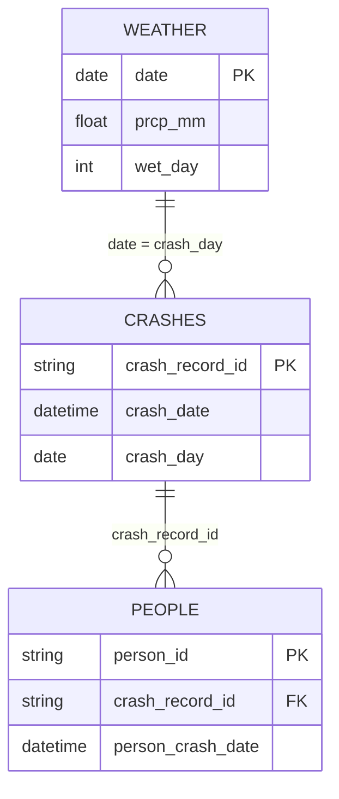

## Status Report

### Dataset Quality Assessment

**Section Prepared by:** Yifei Zhang\
**Role:** Assess the quality of the datasets\
**Data:** Chicago traffic crashes, people involved in those crashes, and daily weather at O'Hare, 2023–2024\

This report looks at how accurate, complete, timely, and consistent the three raw datasets are. The numbers were measured from the raw files, not guessed. Blank fields are treated as missing. Labels such as UNKNOWN or OTHER are kept as their own categories; they are not treated as blank.

The three files are:

- Crashes: `data/raw/crashes_2023_2024.csv` (222,810 rows, 49 columns)
- People: `data/raw/people_2023_2024.csv` (491,892 rows, 29 columns)
- Weather: `data/raw/noaa_usw00094846.csv` (29,249 raw rows; 731 of those days fall in 2023–2024)

A short script, [`Data quality Assessment.py`](scripts/Data%20quality%20Assessment.py), can be run to recompute these counts.

Every crash and every person has an ID, there are no duplicate records, and every crash date falls inside 2023–2024. Every person can be linked to a crash, and every crash day has a weather observation at O'Hare. The main problems are incomplete fields, a few impossible or unlikely values (especially ages and some map coordinates), disagreements between the files, and 509 crashes with no people listed. Blanks in special-case fields should not automatically be read as "no."

---

#### 1. Crashes dataset

All 222,810 crash IDs are present and unique, with no exact duplicate rows. Every `crash_date` falls between 2023-01-01 00:00:00 and 2024-12-31 23:47:00. Crash date, number of units, crash type, weather, lighting, and road surface have no blanks.

- **Injury totals missing (509 crashes, 0.23%):** Keep as missing. Do not replace with zero. These are the same 509 crashes with no People rows.
- **Most severe injury missing (512 crashes):** Keep as missing. 509 have no People rows; flag the other 3 for review. Do not guess.
- **Latitude and longitude missing (2,222 crashes, 1.00%):** Keep the crashes for dates and counts, but leave them off maps. Do not invent coordinates.
- **Coordinates recorded as 0,0 (17 crashes):** Not a real Chicago location, and outside a simple Chicago-area box. Treat as invalid, same as missing. Do not plot them or drop the crash.
- **Optional flags mostly blank (often 67%–99%), including hit-and-run, work zone, and lane count:** A blank does not clearly mean No, so do not fill it with "N." `lane_cnt` is 99.99% missing and should not be a main variable.
- **UNKNOWN categories:** weather 18,375 (8.25%), lighting 14,973 (6.72%), and road surface 29,176 (13.09%). Keep UNKNOWN as its own category. Do not fill it with CLEAR or DRY.
- **Late police notification:** 21,493 crashes more than one day later, 372 more than 30 days later, and 139 notifications in 2025 or later (as late as 2025-12-29). Use the crash date, not the notification date. Optionally flag late reports. No notification is earlier than the crash itself.

---

#### 2. People dataset

All 491,892 person IDs are present and unique, with no exact duplicate rows and no repeated person-and-crash pairs. Every person has a `crash_date` from 2023-01-01 through 2024-12-31, and every person links to a crash (100% match).

Age is missing for 143,698 people (29.21%). Among filled-in ages, 1 person has age **-59** (impossible), 0 are older than 110, and 1 is age 110. 3,074 people are listed as age 0: this can be a real infant passenger (1,109 rows), but not for other roles — 1,896 drivers, 41 pedestrians, 25 bicyclists, and 3 people in non-motor vehicles (1,965 in total).

- **Missing age (143,698 people, 29.21%):** Do not fill in an average age. Use an "unknown" age group in summaries.
- **Age is -59 (1 person):** Set this age to missing. Keep the person.
- **Age is 0 for non-passengers (1,965 people):** Set these ages to missing. Keep the 1,109 passengers with age 0.
- **Injury classification missing (101 people, 0.02%):** Do not recode as "no injury." Keep it missing, and keep the injured flag missing too.
- **cell_phone_use almost entirely blank (491,890 people):** Do not use this field, and do not treat blank as "no phone use."

---

#### 3. NOAA weather dataset (O'Hare, station USW00094846)

The raw file has 29,249 rows, from 1946-10-09 through 2026-11-10. For 2023–2024, all 731 days are present (including 2024-02-29), with no missing dates, no repeated station-date rows, and no missing PRCP, TMAX, TMIN, SNOW, or SNWD values. No day has a high temperature below the low temperature, and there are no negative precipitation or snow values.

The CSV headers do not state units. NOAA's GHCN-Daily documentation says PRCP is in tenths of a millimeter, TMAX and TMIN are in tenths of a degree Celsius, and SNOW and SNWD are already in millimeters. In 2023–2024 there are 260 days with precipitation above zero and 471 days with numeric PRCP of zero. 79 of those "zero" days have a trace flag (`T` in the PRCP attributes).

- **Many years outside 2023–2024 (27,839 days before; 679 after):** Filter the weather table to 2023–2024 only. Leave the raw file unchanged.
- **Units are not written in the CSV header:** Convert PRCP, TMAX, and TMIN by dividing by 10 (to mm and °C). Leave SNOW and SNWD as millimeters.
- **Trace precipitation recorded as PRCP = 0 (79 days):** Add a `prcp_trace` flag. Do not change the numeric PRCP value. If a "wet day" is PRCP > 0, say clearly that trace days are counted as dry.
- **Weather is from one airport station (O'Hare):** Use it as a city-wide daily summary, not the exact condition at the crash time or street.

---

#### 4. Problems that appear when the files are compared

Every person matches a crash (491,892 / 491,892), and every crash date has a weather day at O'Hare (222,810 / 222,810). Handle the issues below with flags and careful rules, not by deleting rows.

- **A crash has no people listed (509 crashes, 0.23%):** Keep these crashes in crash counts and daily totals. Leave injury outcome unknown, not zero.
- **Different times for the same crash (49 people in 25 crashes; 29 also differ by calendar day):** Keep both times. Use the Crashes date as the official crash day when joining to weather. Add a mismatch flag. Do not overwrite either timestamp.
- **Crash injury total does not match a count of injured people (240 of 222,301 crashes that have people):** Keep both numbers and list the disagreements for review. Do not auto-correct one file with the other.
- **Crash "most severe injury" does not match the people in that crash (3 disagreements, plus 3 crashes that have people but a blank severity):** Keep the original values, flag them, and do not invent a correction.
- **Some crashes have people whose injury is unknown (76 crashes):** Only count known injuries. Do not treat an unknown injury as "not injured."

---

#### 5. Short recommendations for the next steps

Do not drop rows because a field is missing or a value looks wrong, and do not fill in missing ages, injuries, locations, or weather with averages or zeros. In cleaning, fix only clear errors (age -59; age 0 for non-passengers) by setting those ages to missing, and add simple flags and groups. In integration, keep every crash, use the Crashes date to assign weather, and build separate person-level, crash-level, and daily tables. Be careful with almost-empty fields (`lane_cnt`, `cell_phone_use`) and with UNKNOWN categories.

The raw data are good enough to use for this project if these limits are respected and documented.

# Data Cleaning
**Responsible Members:** Jacob Lee (this section) and Eric Xu (see [Data Cleaning (continued)](#data-cleaning-continued))

## Overview

I cleaned the three datasets based on the issues identified in Yifei's data quality assessment. The main goal was to fix clearly incorrect values and keep as many records as possible.

I used Python and pandas for cleaning. The code is in clean_data.py.

## Chicago Crashes

The Crashes dataset contains 222,810 records. Most of the important fields were complete, so I did not remove any crash records.

I found 17 crashes with coordinates recorded as (0, 0), which is not a valid location in Chicago. I changed those coordinates to missing values but kept the crash records. I also added flags for missing coordinates and missing injury information.

There were 509 crashes with missing injury totals. I kept these values missing instead of replacing them with zero because missing information does not mean no injury.

## Chicago People

The People dataset contains 491,892 records.

One person had an age of -59, and 1,965 non-passengers were recorded as age 0. I changed these values to missing but kept the original person records. I kept the 1,109 passengers with age 0 because they could be infants.

I also created age groups for later analysis. I placed people with missing or invalid ages in an "Unknown" age group.

For injury classifications, I created an indicator to distinguish injured and non-injured people. Missing or unrecognized injury classifications were not counted as having no injury.

## NOAA Weather

The original NOAA file contains weather observations from many years. I filtered it to 2023 and 2024, leaving 731 daily observations.

I converted precipitation from tenths of millimeters to millimeters and temperature from tenths of degrees Celsius to degrees Celsius. Snowfall and snow depth were already recorded in millimeters.

## Cleaning Results

| Dataset         | Before Cleaning | After Cleaning |
| --------------- | --------------: | -------------: |
| Chicago Crashes |         222,810 |        222,810 |
| Chicago People  |         491,892 |        491,892 |
| NOAA Weather    |          29,249 |            731 |

The cleaning process kept all crash and person records.

I saved the cleaned datasets separately, so the original files would not be overwritten. 

## Remaining Issues

Some issues cannot be resolved through cleaning alone. For example, 509 crashes have no matching People records, and some crash injury totals do not agree with the person-level records. These values were not changed because there was not enough information to determine which values were correct.

The next step is to integrate the cleaned datasets and check whether the joins work correctly.

# Data Cleaning (continued)
**Responsible Member:** Eric Xu

## Why this section exists

Before integrating the data, I checked Jacob's cleaning script, `scripts/clean_data.py`, against Yifei's quality assessment. The script runs from a fresh clone and keeps every record. All of Yifei's single-table counts reproduce: 17 zero coordinates, 2,239 missing coordinates after cleaning, 509 missing injury totals, 512 missing severities, 1 age of -59, 1,965 non-passenger ages of 0, 101 missing injury classifications, 731 weather days, 79 trace days and 260 wet days. However, I found six gaps that would have affected integration or reproducibility. I fixed them on top of Jacob's work. Each one is described below as problem, impact, fix, and result. Two of the fixes change Jacob's script, and I explain why for each.

## 1. Cross-table problems were not handled

- **Problem:** The cleaning did not check any of the problems in Section 4 of the quality assessment: crashes with no people, timestamp mismatches, injury total and severity mismatches, and unknown injuries. The overview also said the datasets had been checked to connect through crash IDs and dates, but the code did not do this check.
- **Impact:** Integration would have joined the tables without knowing which crashes disagree between files. Injury rates and weather-by-day results could have silently used inconsistent records.
- **Fix:** We decided to handle these problems in the integration step, where both tables are read together. `scripts/integrate_data.py` uses Yifei's exact rules (see [Data Integration](#data-integration)). I removed the unsupported sentence from the overview above.
- **Result:** All six counts from Yifei's assessment are reproduced and flagged. The script stops if any count changes.

## 2. The text "NA" was read as missing (change to Jacob's script)

- **Problem:** `read_csv` used pandas' default rules. These rules turn literal text such as "NA" or "N/A" into missing values.
- **Impact:** The People table had more missing values than Yifei measured: `hospital` +2,194, `ems_agency` +2,676, `drivers_license_class` +317, `ems_run_no` +258, `city` +4, `zipcode` +1. The fields used in our analysis (age and injury) were not affected, but the cleaned data did not agree with the quality assessment.
- **Fix:** I added `keep_default_na=False, na_values=[""]` to `read_csv`, which is the same rule used in Yifei's script. Only truly empty cells are missing now.
- **Result:** For every People column, the missing count now equals the blank count in the raw file. Row counts did not change. Age groups, the injured flag and the invalid-age flag are identical to before. The crashes output did not change at all (same SHA-256), because the Crashes file has no such text.

## 3. IDs and ages were saved as decimals (change to Jacob's script)

- **Problem:** Columns with some blank cells were stored as decimals, so `vehicle_id` was written as `1668221.0` and `age` as `54.0`.
- **Impact:** A text join on `vehicle_id` would fail (`"1668221.0"` is not equal to `"1668221"`), and the ages looked wrong to readers. Our main key, `crash_record_id`, was not affected.
- **Fix:** `crash_record_id`, `person_id` and `vehicle_id` are now read as text. `age` and `age_original` use pandas' nullable whole-number type (`Int64`), which allows blanks.
- **Result:** The output now shows `1668221` and `54`. Age groups and all age counts are unchanged: 145,664 missing ages after cleaning (143,698 originally blank + 1,966 corrected) and 1,109 passengers aged 0 kept.

## 4. Cleaning documentation was incomplete

- **Problem:** The text did not give the run command, the output folder, or the meaning of the new columns. It also did not state the trace-day rule or the single-station limitation, both of which Yifei asked for.
- **Impact:** A grader could not easily rerun the step or interpret the output columns.
- **Fix:** I kept Jacob's paragraphs and added the table below.
- **Result:** Every cleaning output and every added column is documented below.

## 5. Large outputs were not git-ignored

- **Problem:** `.gitignore` excluded only the raw CSV files.
- **Impact:** The cleaned crashes file (135 MB) and people file (168 MB) are over GitHub's 100 MB limit, so an accidental `git add .` would have made the push fail.
- **Fix:** I added `data/clean/*.csv` and `data/integrated/*.csv` to `.gitignore`. The small summary files and the 340-row review list are still committed.
- **Result:** After a full run, `git status` is clean.

## 6. Package versions were not pinned

- **Problem:** `requirements.txt` listed `pandas` and `requests` without versions.
- **Impact:** A grader would install whatever version is newest. A future change to a pandas default could alter the results or break the scripts.
- **Fix:** I pinned the tested versions (pandas 3.1.1, numpy 2.5.5, requests 2.34.2 and their dependencies). The README now states Python 3.13 and the exact setup commands.
- **Result:** A fresh clone with a new virtual environment reproduces the same output checksums.

Yifei also suggested an optional flag for late police notifications. We skipped it because all of our analysis uses `crash_date`, not the notification date.

## Outputs and new columns

Run with `python scripts/clean_data.py` after `python scripts/download_data.py`, or run everything with `python scripts/run_all.py`. The outputs go to `data/clean/`:

| File | Rows | Contents |
| --- | ---: | --- |
| `crashes_clean.csv` | 222,810 | All original crash columns, plus the new columns below |
| `people_clean.csv` | 491,892 | All original people columns, plus the new columns below |
| `weather_clean.csv` | 731 | O'Hare daily weather for 2023-01-01 to 2024-12-31 |
| `cleaning_summary.json` | – | Input and output SHA-256 values and all cleaning counts |

| Table | New or changed column | Meaning |
| --- | --- | --- |
| crashes | `crash_day` | Calendar date of `crash_date` (YYYY-MM-DD), used to join weather |
| crashes | `invalid_coordinates` | True if the raw coordinates were (0, 0); these were set to missing (17) |
| crashes | `missing_coordinates` | True if latitude or longitude is missing after cleaning (2,239) |
| crashes | `injury_total_missing` | True if `injuries_total` is blank (509); not replaced with 0 |
| crashes | `severity_missing` | True if `most_severe_injury` is blank (512) |
| people | `person_crash_day` | Calendar date of the People file's own `crash_date` |
| people | `age` | Age as a whole number; -59 and non-passenger 0 were set to missing |
| people | `age_original` | Age as recorded, before the correction |
| people | `invalid_age` | True if the age was corrected to missing (1,966) |
| people | `age_group` | 0-17, 18-24, 25-34, 35-44, 45-54, 55-64, 65+, or Unknown |
| people | `injured` | 1 = any injury, 0 = no indication of injury, blank = unknown (101) |
| weather | `prcp_mm` | Precipitation in mm (raw tenths of mm ÷ 10) |
| weather | `tmax_c`, `tmin_c` | Maximum and minimum temperature in °C (raw tenths ÷ 10) |
| weather | `snow_mm`, `snwd_mm` | Snowfall and snow depth in mm (already in mm) |
| weather | `prcp_trace` | True if NOAA marked a trace of precipitation (`T`); 79 days |
| weather | `wet_day` | 1 if `prcp_mm` > 0 (260 days), else 0 |

**Trace-day rule:** A trace day has numeric precipitation of 0 and a `T` flag. We keep the value at 0 and set `prcp_trace` to True. Because `wet_day` is defined as `prcp_mm > 0`, **trace days count as dry days** (79 of the 471 dry days).

**Single-station caveat:** All weather comes from one station at O'Hare Airport (`USW00094846`). We use it as a city-wide daily summary. It does not describe the exact weather at the time or street of each crash.

# Data Integration
**Responsible Member:** Eric Xu

## What was done

Integration combines the three cleaned tables so that each research question can be answered at the correct counting unit. Following Yifei's recommendations, the integration keeps every crash and every person, uses the Crashes date to assign weather, and builds three separate tables: person-level, crash-level, and daily. It does not delete or overwrite any value. Problems are marked with flags instead.

The work is in [`scripts/integrate_data.py`](scripts/integrate_data.py), written in Python with pandas. It reads the cleaned files from `data/clean/` and writes to `data/integrated/`. If the cleaning step has not been run, it stops with a message saying so. The full workflow, including this step, is run by [`scripts/run_all.py`](scripts/run_all.py). The counts below come from `data/integrated/integration_summary.json` after a complete run.

### Join keys

1. **People → Crashes** on `crash_record_id`. This is a many-to-one join, because several people can be in one crash. pandas checks the join type with `validate="many_to_one"`.
2. **Crashes → Weather** on `crash_day = date`. This is also many-to-one: one O'Hare weather row per day. People get their weather through their crash's official `crash_day`, not through their own timestamp.
3. **Daily table:** crashes are counted per day, then joined onto the 731-day weather calendar, so that every day in 2023–2024 appears even if it has no crashes.

### Output tables

| File (in `data/integrated/`) | Rows | Columns | Unit and use |
| --- | ---: | ---: | --- |
| `person_level.csv` | 491,892 | 27 | One row per person. Used for injury proportions by person type, age group, and wet or dry day (questions 2–4). |
| `crash_level.csv` | 222,810 | 47 | One row per crash, with people summary, flags, and weather |
| `daily.csv` | 731 | 13 | One row per day, with crash counts and weather. Used for crashes on wet vs. dry days (question 1). |
| `cross_table_review.csv` | 340 | 16 | Crashes with any cross-table flag |
| `integration_summary.json` | – | – | Row counts, match rates, flag counts, and input and output SHA-256 values |

Columns added by integration:

| Table | Column | Meaning |
| --- | --- | --- |
| crash, person, daily | `prcp_mm`, `tmax_c`, `tmin_c`, `snow_mm`, `snwd_mm`, `prcp_trace`, `wet_day` | O'Hare weather for the official crash day |
| crash | `has_people` | True if the crash has at least one People row |
| crash | `person_count` | Number of people in the crash (blank if none are listed) |
| crash | `injured_people` | People with a known injury (`injured` = 1) |
| crash | `known_injury_people`, `unknown_injury_people` | People with a known or unknown injury status |
| crash | `people_most_severe` | Most severe injury among the crash's people |
| crash, person | `date_mismatch`, `day_mismatch` | Timestamp differs between files, or the calendar day differs (X2) |
| crash | `injury_total_mismatch`, `severity_mismatch`, `severity_blank_with_people`, `has_unknown_injury` | Flags for X3, X4 and X5 |
| person | `person_crash_date` | The People file's own timestamp, renamed from `crash_date` |
| person | `crash_date`, `crash_day`, `weather_condition`, `lighting_condition`, `roadway_surface_cond` | Official crash time and conditions from Crashes |
| daily | `crash_count`, `crashes_without_people`, `person_count`, `injured_people`, `unknown_injury_people` | Daily totals |

### Match rates and checks

These checks run every time the script runs. The script stops with an error if any count is different from the expected value.

| Check | Result |
| --- | --- |
| People matched to a crash | 491,892 / 491,892 (100%) |
| Crashes with at least one person | 222,301 / 222,810 (99.77%) |
| Crashes matched to a weather day | 222,810 / 222,810 (100%) |
| Weather days with at least one crash | 731 / 731 |
| Rows kept | All crashes and all people, with no duplicates created by the joins |
| Daily totals | Sum to exactly 222,810 crashes and 491,892 people |
| Person weather day | Always equals the official Crashes day |
| Injured flag | Agrees with `injury_classification` for every person whose injury is known |

### Cross-table problems (X2–X5)

The script checks each problem using the same rules as Yifei's assessment script. It asserts the expected count and stops with "CHECK FAILED" if the count is different.

| Problem | Impact if ignored | Fix | Result |
| --- | --- | --- | --- |
| **Crashes with no people** | Treating them as zero injuries would understate injury rates. | Keep these crashes in crash counts and daily totals. `has_people` = False, and the people counts stay blank (unknown), not 0. | 509 crashes (0.23%), the same 509 with blank `injuries_total` |
| **X2: different timestamps for the same crash** | A person could be assigned the weather of the wrong day. | Keep both timestamps: `crash_date` from Crashes and `person_crash_date` from People. Flag them with `date_mismatch` and, when the calendar day differs, `day_mismatch`. Use the Crashes date as the official day for weather. | 49 people in 25 crashes; 29 people (in 16 crashes) differ by calendar day. All matched Yifei. |
| **X3: `injuries_total` does not match the number of injured people** | Injury counts would depend on which file is used. | Keep both values, `injuries_total` and `injured_people`. Flag them with `injury_total_mismatch` and add them to the review list. Neither file is used to correct the other. | 240 of 222,301 comparable crashes, matching Yifei. In all 240, the People file has more injured people than the crash total. |
| **X4: `most_severe_injury` does not match the people** | Severity summaries would disagree between tables. | Add `people_most_severe` (the most severe person in the crash). Flag disagreements with `severity_mismatch`, and blank severity with people listed with `severity_blank_with_people`. | 3 disagreements + 3 blank-with-people, matching Yifei. The other 509 blank severities are the crashes with no people. |
| **X5: people with unknown injury** | Counting unknowns as "not injured" would bias injury proportions downward. | Count only known injuries: `injured_people` counts people with `injured` = 1, and `unknown_injury_people` counts blanks. Flag crashes with `has_unknown_injury`. | 101 people in 76 crashes, matching Yifei |

All flagged crashes, 340 in total, are saved to `data/integrated/cross_table_review.csv`. For each crash, the file holds both files' values side by side for later review. It is small, so it is committed to the repository.

### Why pandas and not OpenRefine

The integration step is made of joins, group-by counts and checks across two large tables (222,810 and 491,892 rows). pandas does this in one script that runs in about 10 seconds with no manual steps. OpenRefine is designed for interactive cleaning of one table at a time. Using it here would add a manual import and export step, which would break our one-command workflow, so we did not use it.

## What is not done yet

The joins themselves are finished and can be reproduced with `python scripts/run_all.py`. The following course items are still outstanding:

- **Post-integration four-dimension quality assessment.** Yifei's assessment covers the raw files (accuracy, completeness, timeliness, and consistency). The integration script checks row counts, join match rates, and the cross-table flag counts, but we have not yet written a four-dimension quality assessment of the integrated tables.
- **Analysis.** There is no analysis script yet, and we have not answered the four research questions. Step 5 in the README is still marked "to be added."
- **Metadata / data dictionary.** New columns are listed in this report, but the project does not yet have a standalone data dictionary for the cleaned or integrated tables (variable names, types, units, and missing-value codes).
- **Final data report.** This is in progress in the section below, led by Jiacheng Lin, and will be completed after the tables and figures are finalized.

## Future work and improvements

- Write the post-integration quality assessment from the integrated tables and the flags already produced, then add a data dictionary that a reader can use without reading the scripts.
- Add analysis scripts that read `daily.csv` (question 1) and `person_level.csv` (questions 2–4) and write the results in a reproducible way, with no manual steps.
- In the analysis, keep the known limitations in view: weather is a daily reading from one O'Hare station, not the weather at the crash location or time; 509 crashes have no people, so they should count in crash totals but not in injury proportions; and the 340 flagged disagreements (0.15% of crashes) are kept as recorded, because we cannot tell which file is correct. Results that use injury or date fields should be reported with and without the flagged crashes if the difference matters.
- `crash_level.csv` (102 MB) and `person_level.csv` (173 MB) are too large for GitHub. They are regenerated by the workflow. A copy of the cleaned data is on Box (see README); the integrated tables are produced locally by the script.

---

### Final Data Report

**Responsible Member:** Jiacheng Lin

I am responsible for writing the final data report for our study of Chicago traffic crashes and daily weather in 2023–2024. So far, I have reviewed the team's data quality and cleaning sections and identified two decisions the report needs to explain: why crashes without matching person records still count toward daily crash totals, and why missing injury information should not be treated as “no injury.” I will incorporate the findings for all four research questions once the team has verified the joins and finalized the tables and figures.
